# Examples

Start with renderer setup and device enumeration, then move on to compute and rendering. Within
each category, examples progress from basic usage to more advanced resource management and
animation.

Run an example from the repository root using its filename without `.rs`:

```bash
cargo run --example render_basic_triangle
```

The shared [utilities](utils/mod.rs) create the window and renderer, and initialize the renderer
for every example except `creating_renderer`, which demonstrates initialization explicitly. The
flowcharts describe reusable library workflows. Compute and rendering workflows assume an
initialized renderer; device selection, feature requests, and renderer settings are grouped as
renderer configuration.

## Creation, initialization, and device enumeration

### [creating_renderer](creating_renderer.rs)

Creates and initializes a renderer, then selects a graphics device and the features your
application needs. Initialization connects the renderer to your windowing system.

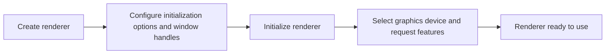

### [enumerate_devices](enumerate_devices.rs)

Discovers available graphics devices and prints their capabilities.

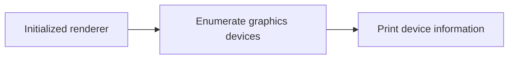

## Compute

### [compute_single_thread_single_frame](compute_single_thread_single_frame.rs)

Executes a GPU computation in a single frame. Creates a compute pipeline, binds IO resources,
records work, and waits for completion before reading results on the CPU.

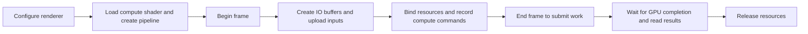

### [compute_single_thread_multi_frame](compute_single_thread_multi_frame.rs)

Keeps multiple frames in flight using a reusable set of resources for each frame slot. Reads
completed results before reusing a slot, then collects pending results when processing finishes.

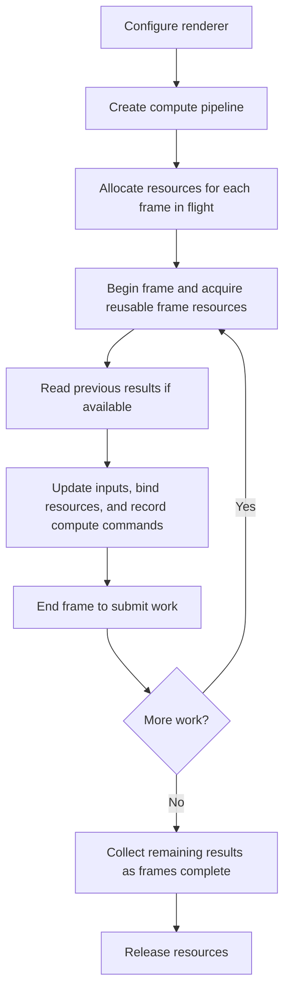

### [compute_multi_thread](compute_multi_thread.rs)

Records GPU computations concurrently using renderer workers. Shares a renderer handle, prepares
resources on worker threads, and coordinates frame completion and resource lifetimes with the main
thread before consuming results.

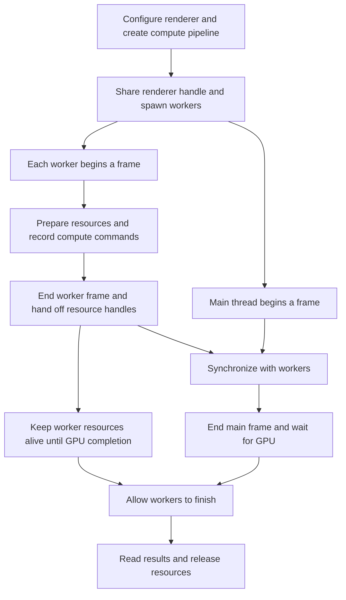

## Rendering

### [render_basic_triangle](render_basic_triangle.rs)

Demonstrates the basic rendering lifecycle: creates a graphics pipeline from shaders, begins a
frame, clears the render target, records a draw, and ends the frame. Shader-generated geometry
keeps resource setup minimal.

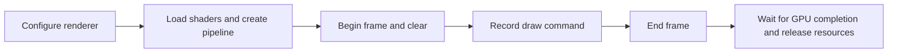

### [render_shapes](render_shapes.rs)

Uses primitive topology to control how vertices form points, lines, and triangles. Creates
pipelines with the appropriate topology and combines their draw commands in one frame.

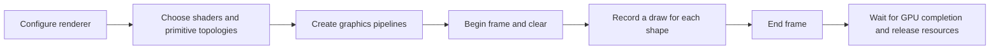

### [render_moving_cubes](render_moving_cubes.rs)

Renders animated geometry using vertex and index buffers. Updates vertex data each frame, binds the
buffers for indexed drawing, and configures pipeline options such as culling and blending.

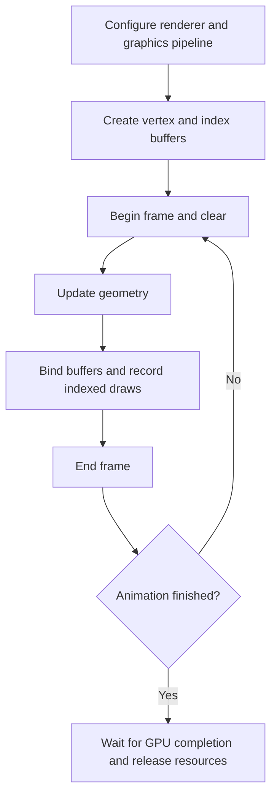

### [render_textures](render_textures.rs)

Applies textures and material properties to geometry. Uploads image data to the GPU, configures
sampling, and binds textures alongside geometry and material uniforms when recording draws.

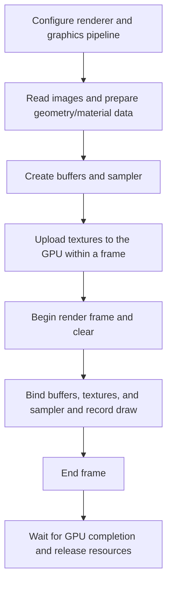

### [render_text](render_text.rs)

Generates renderable text from a font for screen-space, world-space, or extruded rendering.
Prepares text geometry and a font atlas where needed, then uses suitable pipelines and transforms
to draw text within a scene.

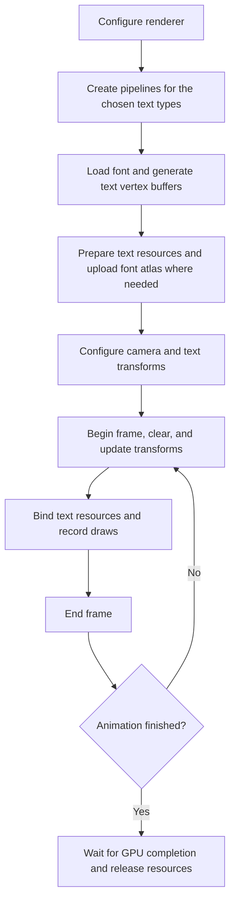

### [render_meshes](render_meshes.rs)

Loads a mesh and renders its parts with their geometry, textures, and materials. Uses a camera and
object transforms to place the mesh in a scene, and stores transform updates in per-frame
resources.

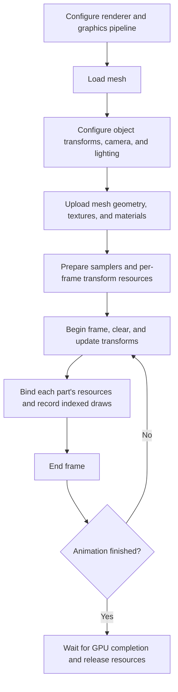

### [render_animated_meshes](render_animated_meshes.rs)

Animates a skinned mesh using a skeleton and animation clips. Samples an animation at the current
playback time, computes joint matrices, and updates GPU resources so the vertex shader can deform
the mesh.

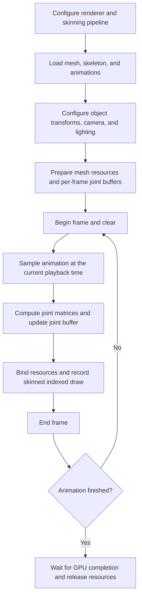
